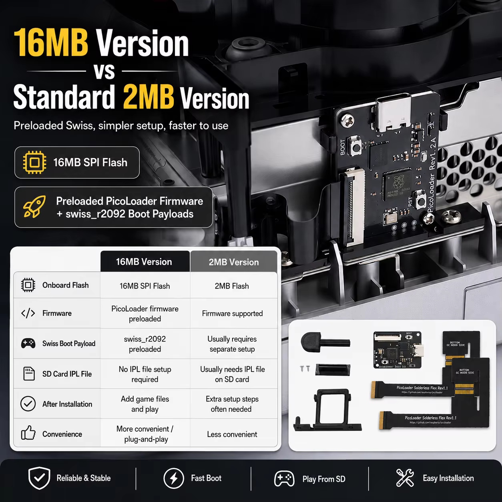
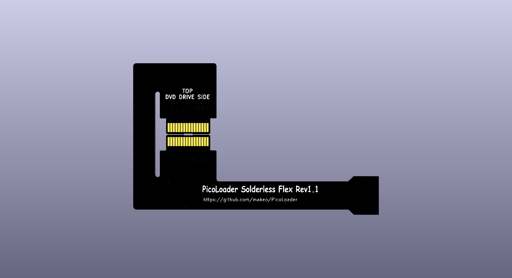

# PicoLoader — hardware

Open-hardware design files for **PicoLoader**, an RP2040-based modchip for the Nintendo
GameCube. The main board carries the RP2040, the SPI flash and a USB-C port, and is wired to
the console through a 30-pin **solderless flex** that taps the DVD-drive flex connector
(footprint symbol `GamecubeConnectors:DVDFlexCN`). No soldering is required for installation.

The **16 MB** version ships with the PicoLoader firmware and the `swiss_r2092` boot payloads
preloaded, so no IPL file is needed on the SD card — copy your game files and play.

All projects are **KiCad 10** (PCB format `20260206`, schematic format `20260306`).



## Versions at a glance

| Folder | Revision | Status | SPI flash | Board size | Footprints |
| --- | --- | --- | --- | --- | --- |
| [`hw/v1.1/`](hw/v1.1) | v1.1 | **Discontinued** — kept for design history | ZD25WQ16CEIGR · 2 MB · USON-8 3×2 mm | 27.21 × 36.04 mm | 37 |
| [`hw/v1.1A/`](hw/v1.1A) | v1.1A | **In production** | ZD25WQ16DEIGR · 2 MB · USON-8 3×2 mm | 27.21 × 36.04 mm | 39 |
| [`hw/v1.2A/`](hw/v1.2A) | v1.2A | **In production** | ZD25WQ128CEIGR · 16 MB · WSON-8 6×5 mm | 27.21 × 36.04 mm | 39 |
| [`hw/flex/`](hw/flex) | flex | **In production** | — | 98.46 × 61.01 mm | 2 |

v1.1 is retired and is published only for reference. The current production board is
**v1.2A**; **v1.1A** is the previous 2 MB revision and remains available as the lower-cost
option.

## What the 16 MB version adds

v1.2A is an evolution of v1.1A. The flash footprint moves from USON-8 3×2 mm to WSON-8
6×5 mm so that a 16 MB part can replace the 2 MB one, which brings:

| | **16 MB (v1.2A)** | **2 MB (v1.1A)** |
| --- | --- | --- |
| Onboard flash | 16 MB SPI flash | 2 MB SPI flash |
| PicoLoader firmware | Preloaded | Supported, has to be flashed |
| Swiss boot payload | `swiss_r2092` preloaded | Usually requires separate setup |
| SD card IPL file | Not required | Usually needs an IPL file on the SD card |
| After installation | Copy game files and play | Extra setup steps are often needed |
| Convenience | Plug-and-play | Requires a bit more work |

Both revisions keep the same PCB outline, the same RP2040, USB-C and 30-pin FFC interface,
so a 2 MB board can be swapped for a 16 MB one in an existing installation.

## Gallery

<p align="center">
  
  
  
</p>

<p align="center"><em>v1.2A (16 MB) · v1.1A (2 MB) · solderless flex</em></p>

## Where to buy

Pre-built units fund the continued development of this hardware and its firmware:

* **v1.1A (2 MB)** — <https://www.aliexpress.com/item/1005012408459349.html>
* **v1.2A (16 MB)** — <https://www.aliexpress.com/item/1005013055513154.html>

If you would rather build your own from these files, that is exactly what the licence is
for — a star on the repository or a note about your build is always appreciated.

## Fabrication files

Ready-to-order Gerber / drill packages, the BOM and the top-side assembly drawing are
published per revision:

* [PicoLoader **v1.2A** (16 MB)](https://github.com/Auroxin/picoloader-hw/releases/tag/v1.2A) — Gerber + drill, BOM, assembly drawing
* [PicoLoader **v1.1A** (2 MB)](https://github.com/Auroxin/picoloader-hw/releases/tag/v1.1A) — Gerber + drill, BOM, assembly drawing

The design sources are in [`hw/`](hw); every fabrication file above is generated from them,
so you can always re-plot from the project instead of trusting an archive.

## 3D-printed parts

A solderless installation also needs the printed bracket that holds the board. The parts live
in [`3d-print/`](3d-print):

| File | Format | Purpose |
| --- | --- | --- |
| `Drive_PlugV1.1.stl` | STL | Drive-side plug, used when the console runs without a disc drive |
| `Fold_KeyV1.2.stl` | STL | Folding key that creases the flex cable at the correct position |
| `picoloader-pcb-plug-20260901.step` | STEP | Mounting bracket that holds the main board (rev 1.2A) |

## Component summary (main board)

| Designator | Part | Package |
| --- | --- | --- |
| U3 | RP2040 | QFN-56 7×7 mm P0.4 mm |
| FLASH1 | ZD25WQ128CEIGR (16 MB, v1.2A) · ZD25WQ16DEIGR (2 MB, v1.1A) · ZD25WQ16CEIGR (2 MB, v1.1) | WSON-8 6×5 mm (v1.2A) · USON-8 3×2 mm (v1.1, v1.1A) |
| U1 | AP2112K-3.3TRG1 LDO | SOT-23-5 |
| Y1 | 12 MHz crystal | SMD 3225 |
| J1 | 30-pin 0.5 mm FFC | Hirose FH12-30S-0.5SH-1 |
| USB2 | USB-C receptacle | HRO TYPE-C-31-M-12 |
| J2, RSW1 | Tactile switch | Panasonic TSA343G00-250J2 |
| D1, D3 | 1N5819WS Schottky | SOD-323 |
| D2 | Indicator LED | 0603 |
| TP3–TP5 | Test points | 1.0 mm pad |

The board is powered from USB-C through the LDO and carries 23 discrete resistors and
capacitors (0402 / 0603).

The schematic symbol block also lists **W25Q256JVEIQ** (32 MB) as an alternative QSPI part
for the same footprint, in case a larger flash is wanted.

## Repository layout

```
.
├── LICENSE                  GPL-2.0
├── NOTICE.md                upstream attribution and file-level provenance
├── extras/                  PCB renders and product graphics
├── 3d-print/                STL / STEP parts for a solderless install
└── hw/
    ├── v1.1/                discontinued — picoloader.kicad_{pro,sch,pcb}
    │   ├── fp-lib-table     project footprint table (${KIPRJMOD})
    │   ├── sym-lib-table    project symbol table (${KIPRJMOD})
    │   ├── Library.pretty   project footprints
    │   └── packages3D/      3D models referenced by the PCB
    ├── v1.1A/               same structure
    ├── v1.2A/               same structure
    └── flex/                Flex.kicad_{pro,sch,pcb}
        ├── fp-lib-table
        ├── sym-lib-table
        ├── GamecubeConnectors.kicad_sym
        └── Library.pretty
```

Every project folder is **self-contained**: `fp-lib-table` and `sym-lib-table` resolve
through `${KIPRJMOD}`, and `packages3D/` only contains the models the PCB actually
references. Clone the repository and open the `.kicad_pro` file of the revision you want; no
extra library installation is needed. Each folder also has a short `README.md` with the
revision-specific details.

## Working with the projects

* Open the `.kicad_pro` file directly in KiCad 10.0 or newer. Older KiCad versions will
  refuse to open the schematic and PCB because of the file format version.
* Footprints from `Library.pretty` are embedded in the PCB files as well, so the boards
  render even if the library is not loaded; the library tables are provided so that
  "update footprint from library" works.
* Symbol libraries `MCU_RaspberryPi_RP2040`, `Type-C` and `W25Q256JVEIQ_TR` are third-party
  libraries and are **not redistributed** here. Each `.kicad_sch` carries a full
  `lib_symbols` cache, so the schematics display and plot correctly; only
  "update symbol from library" will report the missing libraries.
* `Library.kicad_sym` in the board projects is intentionally an empty stub — it only keeps
  the project symbol table consistent with the original design environment.
* Fabrication outputs are not tracked in the repository — each revision has a
  [release](https://github.com/Auroxin/picoloader-hw/releases) with the Gerber / drill
  package, the BOM and the assembly drawing. Re-plot from the project if you want a fresh
  set.

## Acknowledgements

This project exists because of the **PicoLoader open-source community**. Thank you all.

* **makeo** — for creating PicoLoader, for writing the installation documentation, and above
  all for releasing the design under GPL-2.0 so that others can study it and build on it:
  <https://github.com/makeo/PicoLoader>
* **silversteel** — for the flex PCB and the printed mounts that make the solderless install
  possible
* **the PicoLoader community** — for the wiki and installation guides, the boot payload
  converter, the support on Discord, and for testing every revision on real consoles
* **emukidid, Extrems and the swiss-gc contributors** — for Swiss, the software these boards
  boot
* **TeamOffBroadway** — for the idea of intercepting the drive signals with a flex PCB
* **novenary (9ary)** — for gekkoboot

This repository only adds the v1.1A / v1.2A board revisions and the parts needed to build
them; the concept, the flex and the mounts are the work of the people above. If you build one
of these, consider contributing your findings back to the upstream project as well.

## Third-party assets

`packages3D/` contains vendor STEP models (HRO, Hirose, Winbond, Panasonic, RP2040 QFN and
generic passive footprints). They are included purely for mechanical reference and remain
the property of their respective manufacturers.

Footprints in `Library.pretty` that were derived from the official KiCad libraries stay under
the KiCad library licence (CC-BY-SA 4.0); KiCad's design exception means the boards built
from them are not affected by that licence.

## License

This repository is distributed under the **GNU General Public License v2.0 (GPL-2.0)**, the
same licence as the upstream [PicoLoader](https://github.com/makeo/PicoLoader) project it
derives from. See [LICENSE](LICENSE) for the full text and [NOTICE.md](NOTICE.md) for exactly
which files come from upstream.

In practice:

* you may build, modify and **sell hardware** made from these files, including commercially —
  the GPL does not restrict manufacturing or selling products;
* if you redistribute the design files, the modified sources must stay under GPL-2.0, keep
  this notice and the licence, and remain available to whoever receives the design;
* the design is provided **as is**, without any warranty; building and using it is at your
  own risk.
