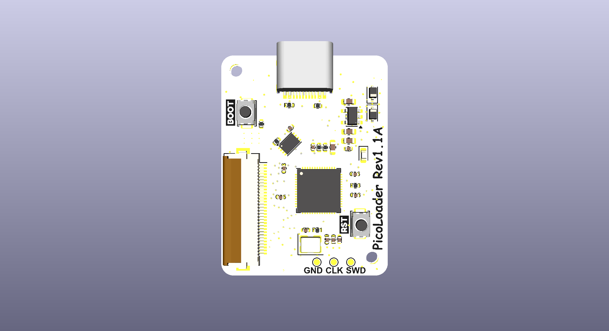

# picoloader v1.1A — in production (2 MB)

The 2 MB revision, still sold alongside v1.2A.

* 27.21 × 36.04 mm, 39 footprints
* SPI flash `ZD25WQ16DEIGR` (2 MB), USON-8 3×2 mm
* footprints migrated to the standard KiCad libraries, silkscreen artwork added

PicoLoader firmware is supported but has to be flashed, and Swiss usually needs a separate
setup step. See [v1.2A](../v1.2A) for the 16 MB version that ships preloaded.

Open `picoloader.kicad_pro` with KiCad 10 or newer.
