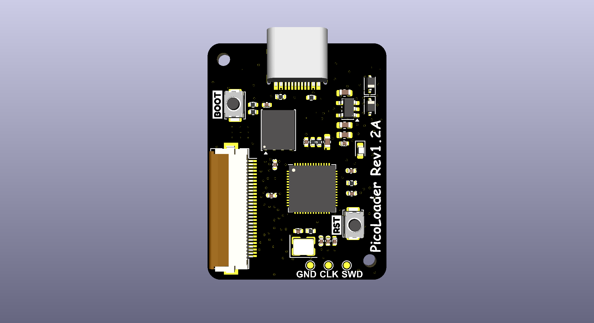

# picoloader v1.2A — in production (16 MB)

The current production revision. It is an evolution of [v1.1A](../v1.1A) with a 16 MB SPI
flash so that the PicoLoader firmware and the `swiss_r2092` boot payloads can be preloaded.

* 27.21 × 36.04 mm, 39 footprints
* SPI flash `ZD25WQ128CEIGR` (16 MB), WSON-8 6×5 mm — the package grew from USON-8 3×2 mm
* ships preloaded: no IPL file needed on the SD card, copy game files and play

The PCB outline, RP2040, USB-C and 30-pin FFC interface are unchanged from v1.1A, so the two
revisions are interchangeable in an existing installation.

Open `picoloader.kicad_pro` with KiCad 10 or newer.
